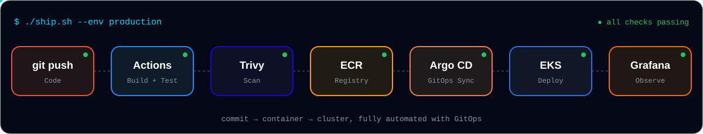

<!-- ═══════════════ HERO (custom animated SVG — assets/header.svg) ═══════════════ -->

  

  
  
  <!--  -->
  

  

<!-- ═══════════════ ABOUT — animated terminal (assets/terminal.svg) ═══════════════ -->
<h2 align="center">🖥️ About Me</h2>

  

<!-- ═══════════════ PIPELINE — how I ship (assets/pipeline.svg) ═══════════════ -->
<h2 align="center">🔄 How I Ship</h2>

  

<!-- ═══════════════ TECH STACK ═══════════════ -->
<h2 align="center">⚡ Tech Stack</h2>

  
    
  

  
  
  
  
  
  
  

<!-- ═══════════════ IMPACT ═══════════════ -->
<h2 align="center">🏆 Impact</h2>
<!-- ✏️ Put YOUR real numbers here. Recruiters read this section first. Delete any card you can't back up. -->

<table align="center">
  <tr>
    <td align="center" width="25%">
      <h3>💰 FinOps</h3>
      AWS cost audits, rightsizing &amp; idle-resource cleanup
    </td>
    <td align="center" width="25%">
      <h3>⏱️ 0 min</h3>
      downtime during blue-green EBS encryption migration
    </td>
    <td align="center" width="25%">
      <h3>☸️ EKS</h3>
      private / air-gapped landing zones in Terraform
    </td>
    <td align="center" width="25%">
      <h3>📊 24×7</h3>
      Datadog + Prometheus alerting on prod workloads
    </td>
  </tr>
</table>

<!-- ═══════════════ PROJECTS ═══════════════ -->
<h2 align="center">🚀 Featured Projects</h2>

  
  
  
  

<b>📂 What each project demonstrates</b>

 

| Project | What it proves | Stack |
|---|---|---|
| **production-platform-engineering** | End-to-end platform: IaC → cluster → GitOps → observability → security | Terraform · EKS · Helm · Argo CD |
| **taskflow-gitops** | Taking a real app (React + Node + Postgres) from Dockerfile to GitOps-managed K8s | Docker · K8s · Argo CD |
| **aws-infra-terraform** | Reusable, composable Terraform modules with clean boundaries | Terraform · VPC · EC2 |
| **aws-ebs-encryption-migration** | Zero-downtime migration runbook with rollback plan | EC2 · EBS · KMS · AMIs |

<!-- ═══════════════ STATS ═══════════════ -->
<h2 align="center">📈 GitHub Analytics</h2>

  
  

  

  <picture>
    <source media="(prefers-color-scheme: dark)" srcset="https://raw.githubusercontent.com/Satishchoudhary94/Satishchoudhary94/output/github-contribution-grid-snake-dark.svg"/>
    <source media="(prefers-color-scheme: light)" srcset="https://raw.githubusercontent.com/Satishchoudhary94/Satishchoudhary94/output/github-contribution-grid-snake.svg"/>
    
  </picture>

<!-- ═══════════════ FOOTER ═══════════════ -->

  

  

